# Opzetten Repository Unity project en readme

In deze voorbereidingsles gaan we een repository opzetten voor ons Unity project.

Hierbij maken we ook een readme aan waarin we de voortgang en resultaten laten zien.

Je hebt in deze les nog weinig of geen ervaring met GitHub nodig. We werken stap voor stap en leggen de begrippen uit wanneer ze voorbij komen.

## Begrippen vooraf

- **Git**: een programma dat bijhoudt welke wijzigingen je in je bestanden hebt gemaakt. Je kunt altijd terug naar een eerdere versie.
- **Repository (repo)**: een map met je project waarvan Git de geschiedenis bijhoudt.
- **Commit**: een opgeslagen momentopname van je wijzigingen, met een korte beschrijving.
- **GitHub**: een website waar je repository online staat, zodat je werk back-up heeft en anderen het kunnen zien.
- **Push**: je commits van je computer naar GitHub sturen.
- **Readme**: een tekstbestand (`readme.md`) dat op de startpagina van je repository wordt getoond. Het is de etalage van je project.

Zorg dat je het volgende hebt geïnstalleerd:

- [Unity Hub](https://unity.com/download) en een Unity-editor versie (bij voorkeur een **LTS**-versie, dat is de meest stabiele versie).
- [Git](https://git-scm.com/downloads)
- Een account op [GitHub](https://github.com/signup).
- Een code-editor, bijvoorbeeld [Visual Studio Code](https://code.visualstudio.com/) (optioneel, maar handig om de readme te bewerken).

## Stap 1: Unity project maken

1. Open **Unity Hub** en klik op **New project**.
2. Kies de juiste Unity-versie (LTS) en een template, In dit geval een  **2D** poject.
3. Geef je project een duidelijke naam, bijvoorbeeld `M2_Peggle`. Gebruik geen spaties of speciale tekens.
4. Kies een locatie op je computer (geen cloud map) en klik op **Create project**.
5. Wacht tot Unity klaar is met laden. Maak eventueel een simpele scène aan en sla deze op (**File > Save**).
6. Sluit Unity af.

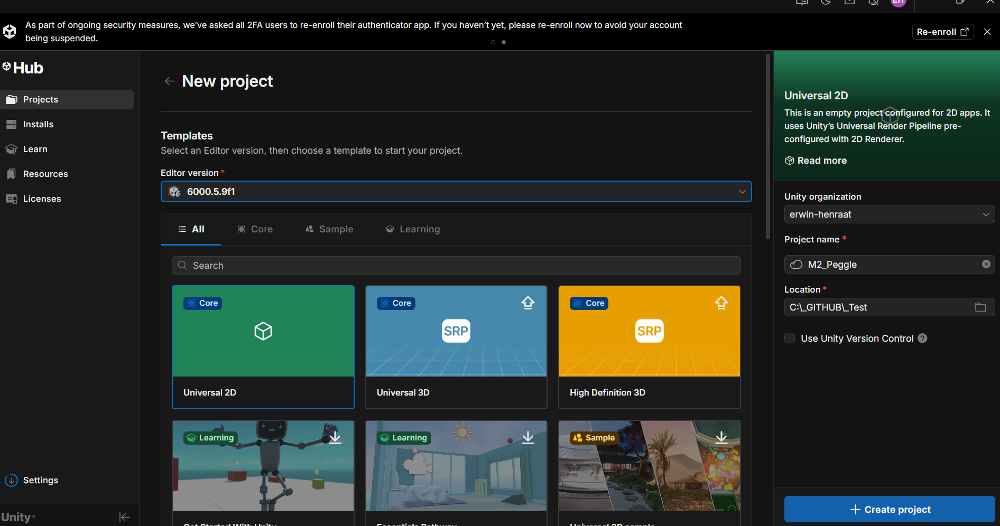

**Controle:** je projectmap bevat nu onder andere de mappen `Assets`, `Packages` en `ProjectSettings`.

### Een .gitignore toevoegen

Unity maakt veel bestanden aan die níet in Git thuishoren, zoals de map `Library` en tijdelijke bestanden. Een `.gitignore` bestand vertelt Git welke bestanden genegeerd moeten worden.

1. Ga naar de [Unity .gitignore van GitHub](https://github.com/github/gitignore/blob/main/Unity.gitignore).
2. Click op `Download raw file` en sla deze op in de Root folder van je Unity project.

Dit is dezelfde folder waar ook je Assets folder in zit!

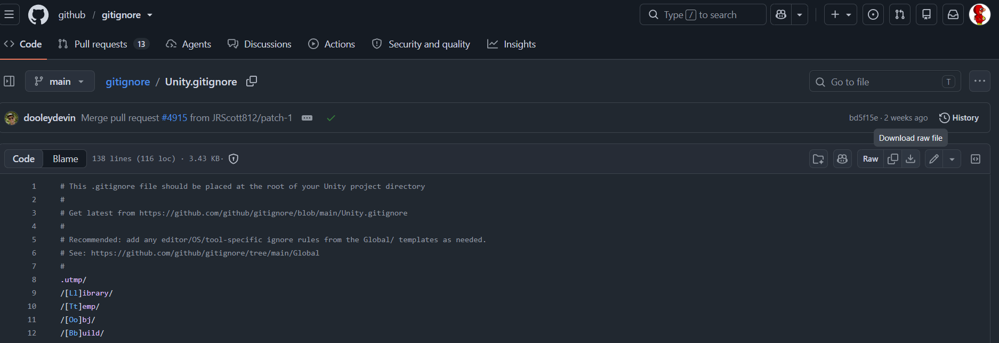

3. Rename de `Unity.gitignore` file naar : `.gitignore`. (Er staat dus niets voor de punt)

## Stap 2: Repository initialiseren

Een repository initialiseren betekent dat je Git vertelt dat deze projectmap door Git bijgehouden moet worden.

1. Open een terminal (PowerShell of Git Bash) in de hoofdmap van je project. Je kunt in de verkenner in de map staan, `Shift` ingedrukt houden en rechtsklikken, en dan kiezen voor *Open in terminal / Open GitBash Here*.

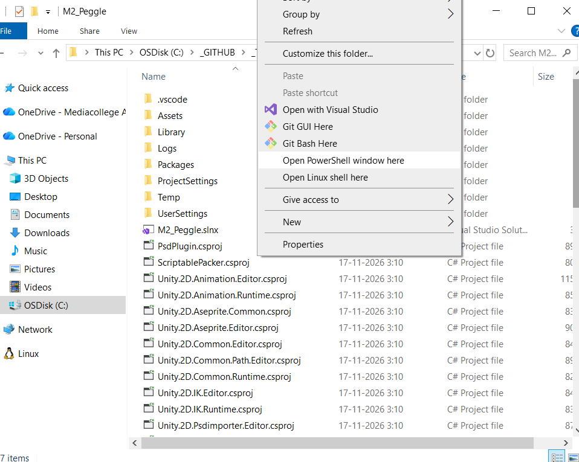

Je kunt ook `cmd` typen in de adresbalk bovenin.

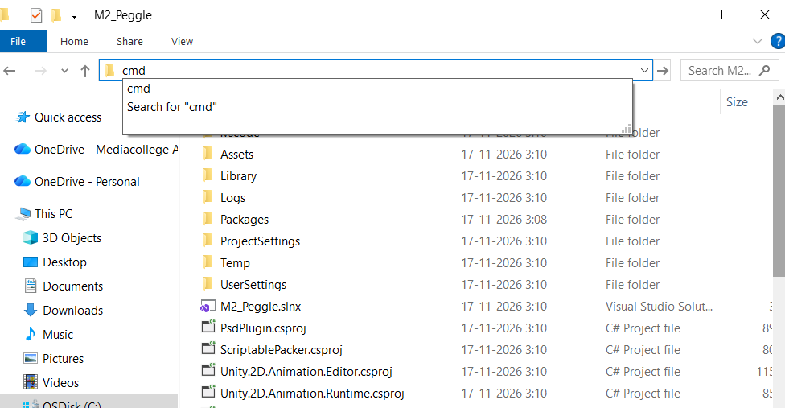

2. Voer de volgende commando's uit:

```bash
git init
git branch -M main
git add .
git commit -m "Eerste versie van het Unity project"
```

- `git init` maakt de repository aan (een verborgen map `.git`).

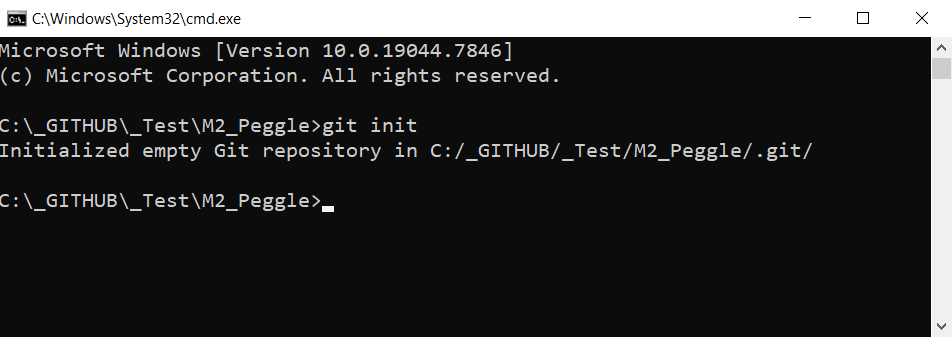

- `git branch -M main` geeft je hoofdtak de naam `main`.

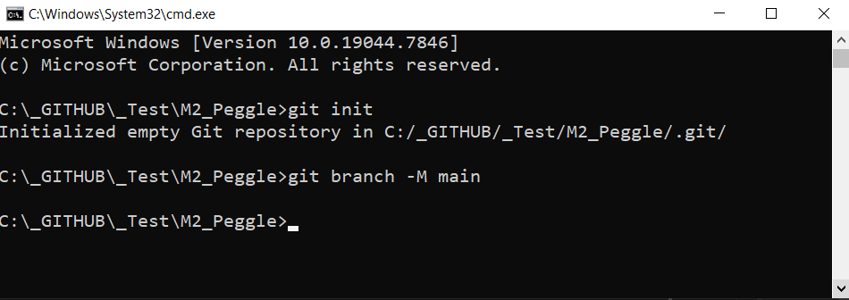

- `git add .` zet alle bestanden klaar om opgeslagen te worden.

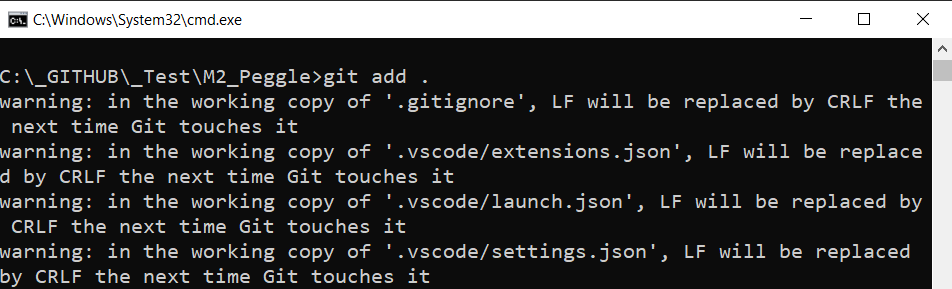

- `git commit -m "initial commit"` slaat de momentopname op.

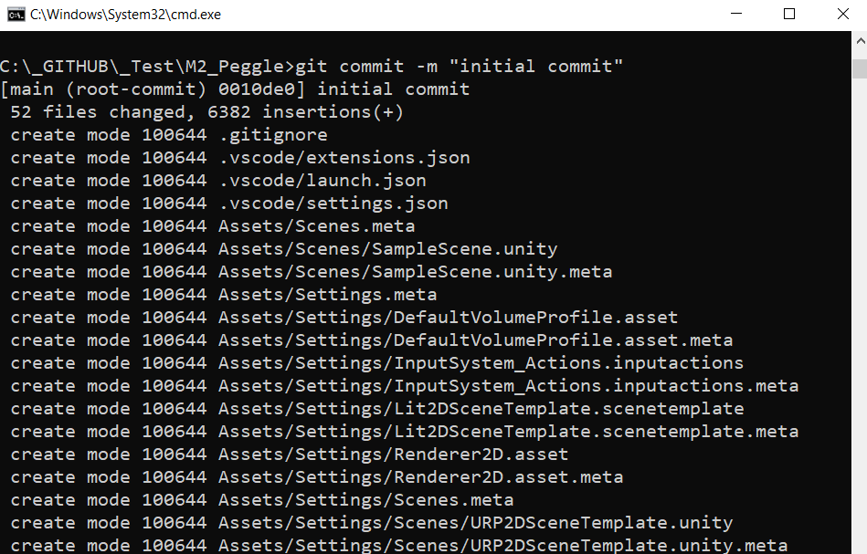

**Controle:** Check of je in de lijst met files geen `/Library` folder tegenkomt. Als dit wel zo is heb je je `.gitignore` file niet goed geplaatst.

**Controle:** `git status` laat nu melden dat er niets meer gewijzigd is (*nothing to commit, working tree clean*).

**Gobal Config:**
<Details>
Eerst moet je Git nog kennen. Als je dat nog niet hebt gedaan, stel dan je naam en e-mailadres in:

```bash
git config --global user.name "Jouw Naam"
git config --global user.email "jouw@email.com"
```

</details>

## Stap 3: Repo uploaden (pushen) op GitHub

1. Log in op GitHub en klik rechtsboven op **+** > **New repository**.

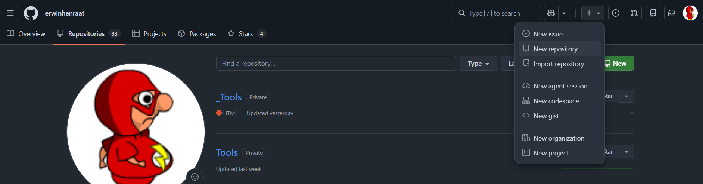

2. Geef de repository dezelfde naam als je project, bijvoorbeeld `M2_Peggle`.
3. Laat de optie **Add a README file** **uitgeschakeld** (we hebben zelf al een readme), en laat ook de .gitignore en license leeg.
4. Klik op **Create repository**.

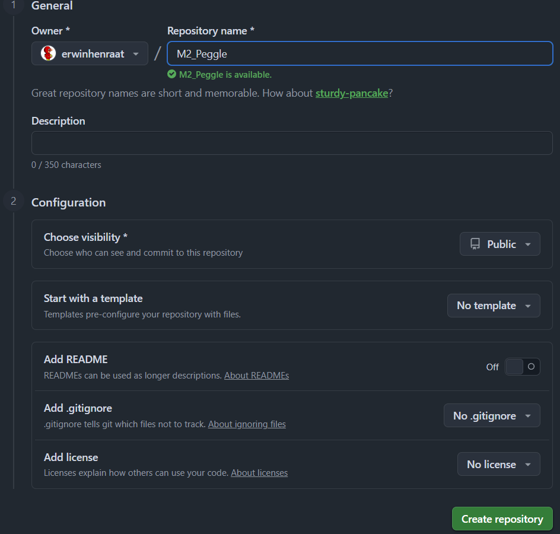

5. GitHub toont nu een adres, bijvoorbeeld `https://github.com/jouw-gebruikersnaam/M2_Peggle.git`. Kopieer dit adres.

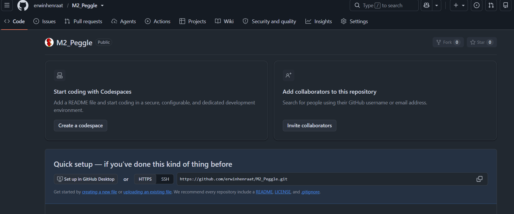

6. Voer in de terminal de volgende commando's uit (vervang de URL door jouw adres):


```bash
git remote add origin https://github.com/jouw-gebruikersnaam/M2_Peggle.git
git push -u origin main
```

- `git remote add origin` koppelt je lokale repository aan die op GitHub.
- `git push -u origin main` stuurt je commits naar GitHub. Bij de eerste keer word je gevraagd om in te loggen. Volg de instructies in het venster dat verschijnt.

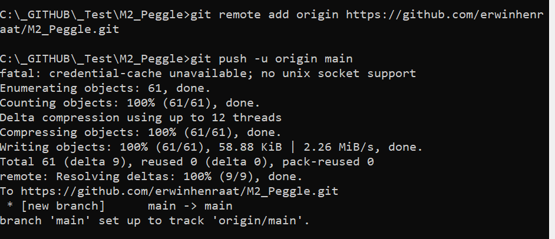

**Controle:** ververs de pagina van je repository op GitHub. Je ziet nu je projectbestanden.

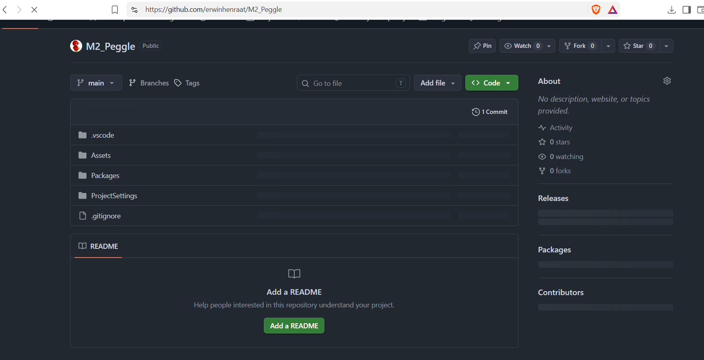

## Stap 4: Readme maken en aanpassen

De readme laat zien wat je project is en hoe ver je bent. Je schrijft deze in **Markdown**: gewone tekst met een paar eenvoudige symbolen voor opmaak.

Maak in de hoofdmap van je project een bestand `readme.md` aan (als die er nog niet is) en open het in je editor.

### Titels

Gebruik `#` voor een hoofdtitel, `##` voor een subtitel en `###` voor een sub-subtitel.

```markdown
# Mijn Eerste Game
## Voortgang
### Week 1
```

### Afbeeldingen weergeven

Zet een afbeelding in je project (bijvoorbeeld in een map `docs/images`) en verwijs ernaar met:

```markdown

```

Het eerste deel tussen `[ ]` is een beschrijving (alt-tekst), het deel tussen `( )` is het pad naar het bestand.

Tip: maak een screenshot in Unity met de knop **Game** en sla deze op als PNG.

### Video's weergeven

Markdown kan geen video's direct afspelen. Dit zijn twee goede opties:

- **Upload naar YouTube** en plaats een link, eventueel met een afbeelding als preview:

  ```markdown
  [](https://www.youtube.com/watch?v=VIDEO_ID)
  ```

- **Een GIF maken** van een korte opname en deze met de afbeeldingssyntax tonen.

```markdown
]
```

### Links plaatsen

```markdown
[Bekijk mijn Unity-tutorial](https://unity.com)
```

### Voortgang bijhouden

Gebruik een takenlijst om bij te houden wat je al gedaan hebt. Zet een `x` tussen de haken als een taak klaar is:

```markdown
## Voortgang
- [x] Unity project aangemaakt
- [x] Repository geïnitialiseerd
- [x] Project gepusht naar GitHub
- [ ] Eerste speelbare scène gemaakt
```

Een voorbeeld van de markdown code voor een kleine simpele readme:

```markdown
# MijnEersteGame

Een simpel 2D-spel gemaakt in Unity.

## Voortgang
- [x] Unity project aangemaakt
- [x] Repository gepusht naar GitHub
- [ ] Speler kan bewegen

## Screenshots


Meer informatie: [Unity documentatie](https://docs.unity3d.com)
```

## Stap 5: Veranderingen committen en pushen

Elke keer dat je iets aanpast (bijvoorbeeld de readme of je game), doe je dit:

1. Bekijk wat er veranderd is:

   ```bash
   git status
   ```

2. Zet de wijzigingen klaar:

   ```bash
   git add .
   ```

3. Maak een commit met een duidelijke beschrijving:

   ```bash
   git commit -m "Readme bijgewerkt met voortgang week 1"
   ```

4. Stuur de commit naar GitHub:

   ```bash
   git push
   ```

**Tip:** maak regelmatig kleine commits met een duidelijke boodschap. Zo zie je in de geschiedenis van je repository wat je wanneer gedaan hebt.

**Controle:** ververs de pagina op GitHub. De nieuwe commit staat bovenaan en je readme toont je voortgang.

## Veelvoorkomende problemen

<details>
- **`git` is niet herkend:** Git is niet geïnstalleerd of je terminal moet opnieuw opgestart worden.
- **Push wordt geweigerd (`rejected`):** controleer met `git remote -v` of de URL klopt.
- **Unity-map `Library` staat op GitHub:** controleer of je `.gitignore` in de hoofdmap staat. Verwijder daarna de map uit Git met `git rm -r --cached Library` en maak een nieuwe commit.
- **Afbeelding wordt niet getoond:** controleer of het pad in de readme exact overeenkomt met de bestandsnaam en hoofdletters.
</details>
