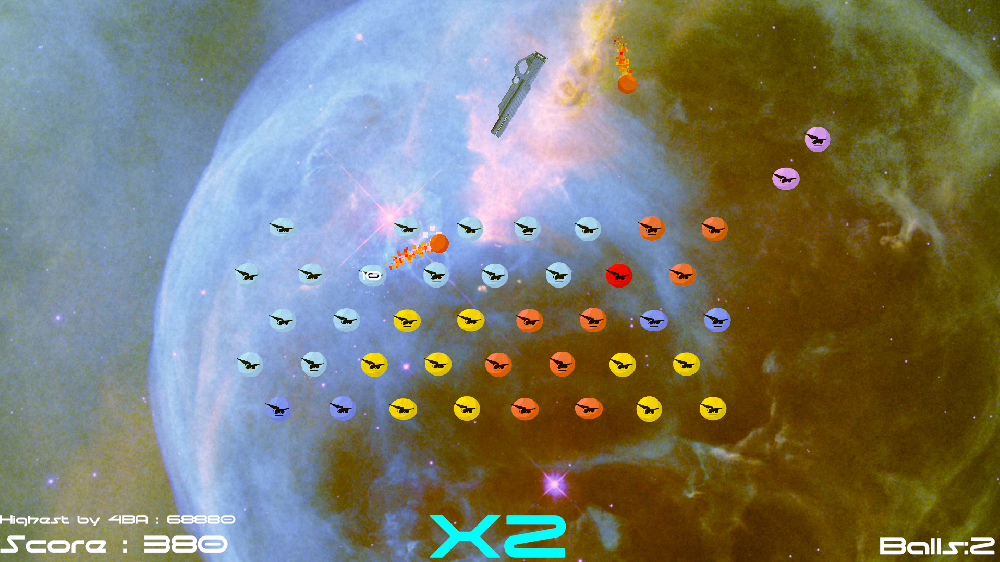

# Peggle Game

## Over de opdracht

Deze periode ga je je eerste eigen game maken in **Unity**. Om je te helpen focussen we op een **Peggle-achtige game**. Zo leer je werken met het physics-systeem, collisions, scoring en gameplay zonder dat je veel code hoeft te schrijven.

Tijdens de lessen krijg je uitleg, demo's en voorbeelden. Daarna werk je zelfstandig verder aan je eigen game.

Maak niet alleen een kopie van Peggle. Geef de game een eigen thema, stijl of extra gameplay-element.

[Hier](https://github.com/erwinhenraat/Galactic_Ricochet/releases) kun je een voorbeeld van een peggle game downloaden, uitpakken en testen.

## Wat ga je zelf maken?

Maak een speelbare Peggle-game met:

- Een systeem om te richten en te schieten.
- Physics en collisions.
- Een score-systeem met combo's.
- Minimaal één speelbaar level.
- Een duidelijke gebruikersinterface (UI).
- Geluiden en visuele effecten.
- Een eigen thema of unieke uitstraling.

## Werkwijze

- De opdracht is individueel.
- Maak in week 1 een GitHub-repository aan.
- Lever zo snel mogelijk een link naar je repository in via Simulise.
- Commit regelmatig je voortgang naar GitHub.

## README Verplicht

In de README van je repository beschrijf je:

1. Je gameconcept.
2. Wat je iedere week hebt gebouwd.
3. Wat je iedere week hebt geleerd.
4. Screenshots of video's van je voortgang.

## Inleveren

Aan het einde van de periode lever je in:

- Een werkend Unity-project op GitHub.
- Een bijgewerkte README. ([Check](./Voorbeeld_Readme.md) hier een voorbeeld)
- Een speelbare build onder **Releases** in je repository.
- Alle behandelde onderdelen uit de lessen verwerkt in je game.

## Beoordeling

Je wordt beoordeeld op:

- Werking van de game.
- Gebruik van Unity Physics.
- Codekwaliteit.
- Creativiteit en eigen invulling.
- GitHub-gebruik en documentatie.
- Volledigheid van de README.
- Eindresultaat van de game.

Daarnaast krijg je een schriftelijke toets over Unity en C#.

---

# Planning
| Week | Docent | Les | Onderwerp | Lesmateriaal | Opdracht |
| --- | --- | --- | --- | --- | --- |
| Week 1 | Kim | — | Geen les vanwege kamp | — | — |
| Week 1 | Erwin | Start | GitHub-repository en Unity-project opzetten | [Projectinformatie](https://github.com/Ma-software-development/lesmateriaal/blob/main/M2/GDV/readme.md) | Repository aanmaken en de link inleveren |
| Week 2 | Kim | Les 1.1 | Introductie Peggle-project en Unity Physics | [Uitleg](https://github.com/Ma-software-development/lesmateriaal/tree/main/M2/GDV/Les_1_1_KV/Lesmateriaal) | [Opdracht](https://github.com/Ma-software-development/lesmateriaal/tree/main/M2/GDV/Les_1_1_KV/Opdracht) |
| Week 2 | Erwin | Les 1.2 | Herhaling C#: variabelen, functies, keuzes, arrays en lijsten | [Les 1.2](https://github.com/Ma-software-development/lesmateriaal/blob/main/M2/GDV/Les_1_2_EH/README.md) | Oefeningen in het lesmateriaal |
| Week 3 | Kim | Les 2.1 | Forces en collisions | [Uitleg](https://github.com/Ma-software-development/lesmateriaal/tree/main/M2/GDV/Les_2_1_KV/Lesmateriaal) | [Opdracht](https://github.com/Ma-software-development/lesmateriaal/tree/main/M2/GDV/Les_2_1_KV/Opdracht) |
| Week 3 | Erwin | Les 2.2 | Richten met een Line Renderer | [Les 2.2](https://github.com/Ma-software-development/lesmateriaal/blob/main/M2/GDV/Les_2_2_EH/README.md) | Oefeningen in het lesmateriaal |
| Week 4 | Kim | Les 3.1 | Triggers en score | [Uitleg](https://github.com/Ma-software-development/lesmateriaal/tree/main/M2/GDV/Les_3_1_KV/Lesmateriaal) | [Opdracht](https://github.com/Ma-software-development/lesmateriaal/tree/main/M2/GDV/Les_3_1_KV/Opdracht) |
| Week 4 | Erwin | Les 3.2 | Combo’s, multipliers en events | [Les 3.2](https://github.com/Ma-software-development/lesmateriaal/blob/main/M2/GDV/Les_3_2_EH/README.md) | Oefeningen in het lesmateriaal |
| Week 5 | Kim | Les 4.1 | Level design en UI | [Uitleg](https://github.com/Ma-software-development/lesmateriaal/tree/main/M2/GDV/Les_4_1_KV/Lesmateriaal) | [Opdracht](https://github.com/Ma-software-development/lesmateriaal/tree/main/M2/GDV/Les_4_1_KV/Opdracht) |
| Week 5 | Erwin | Les 4.2 | Scores versturen | [Les 4.2](https://github.com/Ma-software-development/lesmateriaal/blob/main/M2/GDV/Les_4_2_EH/README.md) | Oefeningen in het lesmateriaal |
| Week 6 | Kim | Uitwerken | Eigen level, UI en gameplay verder bouwen | — | Voeg een eigen feature of power-up toe |
| Week 6 | Erwin | Les 5.2 | Particles, geluid en camera shake | [Les 5.2](https://github.com/Ma-software-development/lesmateriaal/blob/main/M2/GDV/Les_5_2_EH/README.md) | Effecten toepassen in de game |
| Week 7 | Kim | Les 6.1 | Game afronden en uitbreiden | [Uitleg](https://github.com/Ma-software-development/lesmateriaal/tree/main/M2/GDV/Les_6_1_KV/Lesmateriaal) | [Checklist en opdracht](https://github.com/Ma-software-development/lesmateriaal/tree/main/M2/GDV/Les_6_1_KV/Opdracht) |
| Week 7 | Erwin | Voorbereiding | Uitwerktijd en oefentoets | — | Game testen en voorbereiden op de toets |
| Week 8 | Kim en Erwin | Presentatie en toets | Game presenteren en schriftelijke eindtoets | — | Project, README en speelbare build opleveren (voor feedback) |
| Week 9 | Kim en Erwin | Afsluiting | Inhalen & herkansing toets | — | Laatste kans inleveren project, README en speelbare build |

## Week 1

**Maandag t/m Woensdag**
- Kamp

**Vrijdag**

- SD1A: Repository aanmaken.
- SD1C: Repository aanmaken.

---

## Week 2

- VERI/WISJ: Les 1.1 - Voorbeeldconcept Fruity Peggle
- HNR: Les 1.2 - Theorie Basis C#, switch, arrays en lijsten

---

## Week 3

 - VERI/WISJ: Les 2.1 - Forces & Collisions
 - HNR: Les 2.2 - Peggle Mikken met Line Renderer

## Week 4

- VERI/WISJ: Les 3.1 - Score & Triggers
- HNR: Les 3.2 - Combo's, Multipliers & Events

## Week 5

- VERI/WISJ: Les 4.1 - Level Design & UI
- HNR: Les 4.2 - Scores Versturen

## Kerstvakantie

## Week 6

- VERI/WISJ: Uitwerktijd
- HNR: Les 5.2 - Particles, Sounds & Camera Shakes

## Week 7

- VERI/WISJ: Les 6.1 - Afronden en Uitbreiden
- HNR: Uitwerktijd

## Week 8

- VERI/WISJ: Uitwerktijd
- HNR: Toets
- **Vrijdag: Deadline voor feedback**

## Week 9

- VERI/WISJ: Uitwerktijd
- HNR: Hertoets
- Vrijdag: Definitieve deadline

## Eindweek

# Succescriteria

Aan het einde van de opdracht heb je:

- Een speelbare Peggle-game gebouwd in Unity.
- Leren werken met Physics, Collisions en Scoring.
- Je project bijgehouden in GitHub.
- Je ontwikkelproces gedocumenteerd in een README.
- Een eigen gameconcept uitgewerkt tot een compleet eindproduct.
- De schriftelijke toets met minimaal een voldoende afgerond.
