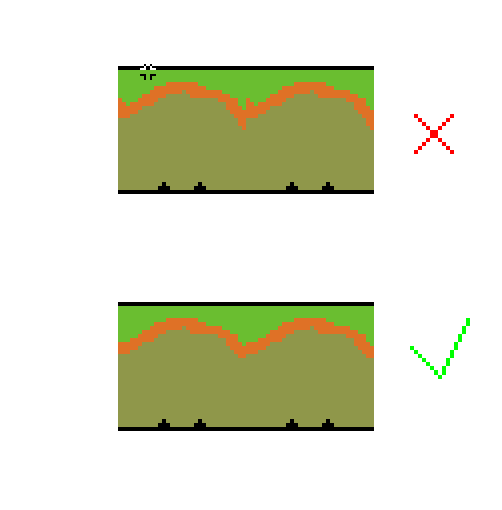
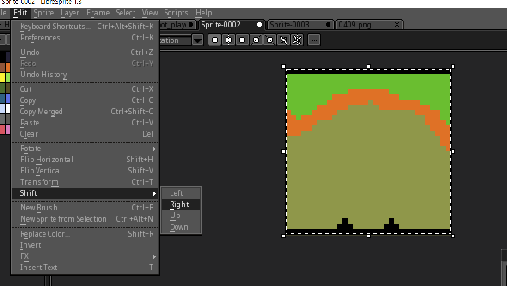
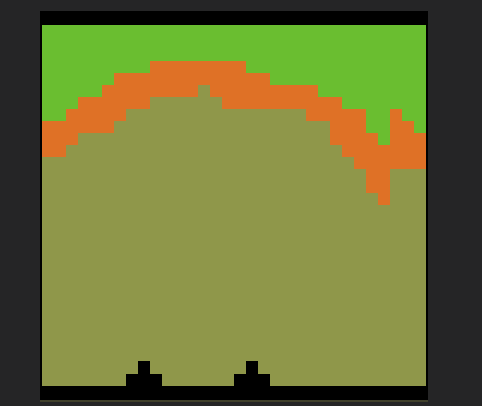

# Week 4 – Herbruikbare Tilesets

## Doel

Deze week maak je de tiles voor het level van je game. Dit zijn de onderdelen waar je speler en je boss mee te maken krijgen, zoals de vloer en de platforms. Je tekent ze als **herbruikbare tiles**: kleine blokjes die je naast en onder elkaar kunt plaatsen om een heel level op te bouwen.

Aan het einde van deze week heb je een set tiles van 32x32 pixels. Die gebruik je in [Week 6](../week%206%20-%20tile%20map%20in%20Unity/README.md) om je level in Unity te schilderen.

### Wat is een tile?

- Een **tile** is een klein vierkantje (hier 32x32 pixels) dat je eindeloos kunt herhalen.
- Een tile is **tilable** als je hem naast een kopie van zichzelf kunt zetten zonder dat er een zichtbare naad ontstaat.

---

## Stap 1 – Nieuw bestand maken voor je tile

1. Open LibreSprite en kies **File > New File** (of `Ctrl+N`).
2. Stel de **Canvas Size** in op `32 x 32` pixels.
3. Kies **Background Color: Transparent**.
4. Klik op **OK**.

---

## Stap 2 – Maak een mockup-bestand

Je maakt ook een mockup: een groot werkveld waarop je al je tiles naast elkaar zet. Zo zie je meteen of ze goed op elkaar aansluiten. Gebruik de achtergrond image van je game ook als achtergrond voor je mockup.

1. Kies **File > New File** (of `Ctrl+N`).
2. Stel de **Canvas Size** in op `1024 x 768` pixels (hetzelfde formaat als de achtergrond uit [Week 3](../week%203%20-%20Achtergrond%20en%20Props/README.md)).
3. Klik op **OK**.
4. Kopieer de achtergrond van je game naar je mockup.

---

## Stap 3 – Bedenk welke tiles je nodig hebt

Maak een lijst met de tiles die je nodig hebt voor je level:

- Minimaal **2 varianten** van de vloer.
- Minimaal **4 varianten** van platforms.

---

## Stap 4 – Tile tekenen

1. Teken je tile binnen je 32x32 pixel werkveld.
2. Zorg dat je tile **tilable** is.

Een tile is tilable als de linkerkant precies aansluit op de rechterkant, en de bovenkant precies op de onderkant. Zo zie je geen naad als je de tile herhaalt.

Het bovenste voorbeeld is niet tilable: de randen sluiten niet aan. Het onderste voorbeeld is wel tilable.

---

## Stap 5 – Maak je tile tilable met Shift

Met de **Shift**-optie verschuif je alle pixels van je tile. Pixels die aan één kant uit beeld vallen, komen aan de andere kant weer terug.

1. Kies **Edit > Shift** en kies een richting, bijvoorbeeld **Right**.

   

2. De naad die niet aansluit, ligt nu niet meer aan de rand maar midden in je tile. Je kunt hem dus makkelijk bewerken.
3. Werk de pixels rond de naad bij met de **Pencil** (`B`), zodat de overgang netjes wordt.
4. Kies weer **Edit > Shift** en verschuif de tile terug naar de oorspronkelijke positie.

Herhaal dit ook voor de richtingen **Up** en **Down**, zodat je bovenkant en onderkant ook aansluiten.

---

## Stap 6 – Test je tiles in je mockup

1. Open je mockup van 1024x768 pixels.
2. Plak je tile erin (`Ctrl+V`) en verplaats hem met de **Move**-tool (`V`).
3. Zet de tile naast een kopie van zichzelf. Zie je geen naad? Dan is je tile goed. Zie je wel een naad? Ga terug naar Stap 5.
4. Herhaal dit voor al je tiles, zodat je mockup een volledig level laat zien.

---

## Stap 7 – Exporteer je tiles

1. Sla je werkbestand op (`Ctrl+S`).
2. Kies **File > Export As** en exporteer elke tile als PNG.

---

## Tips

- Zoom in met de **Zoom**-tool (`Z`) om pixels precies te zien (zie de cheatsheet in [Week 2](../week%202%20-%20Libre%20Sprite/README.md)).
- Gebruik hetzelfde kleurenpalet als je achtergrond en characters, zodat alles visueel bij elkaar past.
- Houd alle tiles op exact 32x32 pixels. Anders passen ze niet netjes in het grid van je Tilemap in Unity.
- Maak varianten van de vloer met kleine verschillen, zoals een scheur of een steen, zodat je level niet saai wordt.

---

## Opdracht

Maak in tweetallen:

1. Minimaal **2 vloertiles** van 32x32 pixels die op elkaar aansluiten.
2. Minimaal **4 platformtiles** van 32x32 pixels. Zorg dat ze in ieder geval in twee paren op elkaar aansluiten.

---

## Oplevering

1. Al je losse tiles (vloer en platforms) als PNG.
2. Je mockup van 1024x768 pixels met daarin alle tiles geplaatst, zodat je kunt zien dat ze op elkaar aansluiten.

Lever je tiles en mockup in op **Simulise**.
