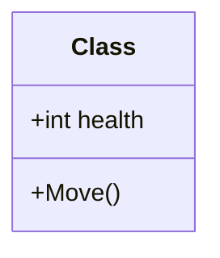
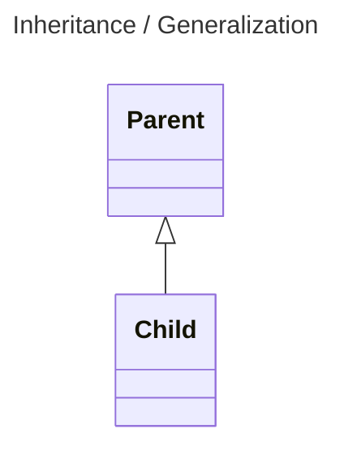
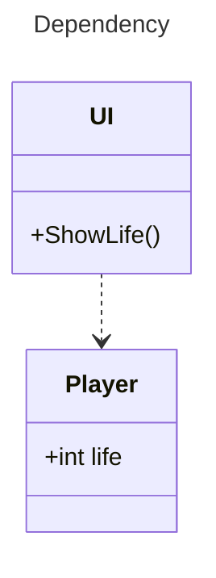
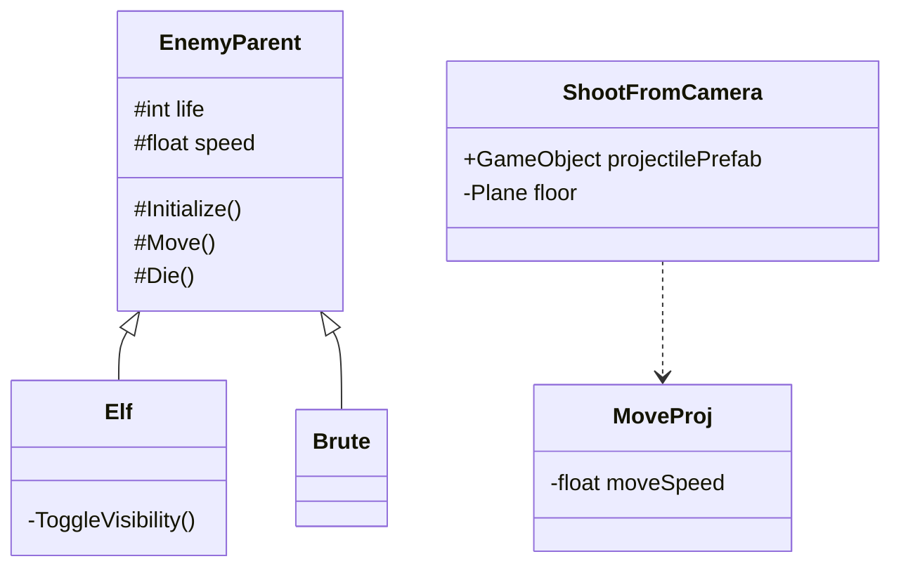
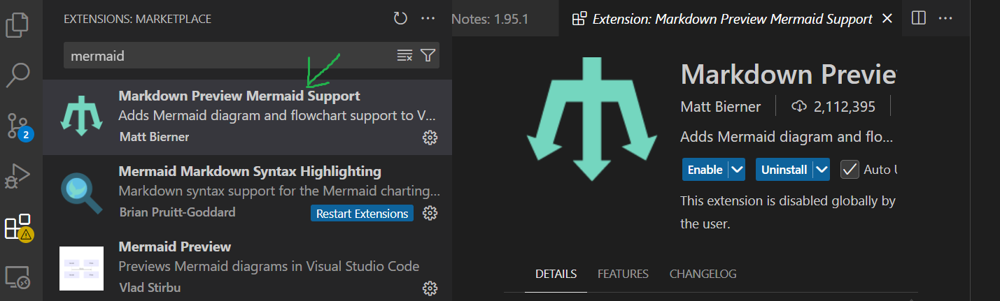
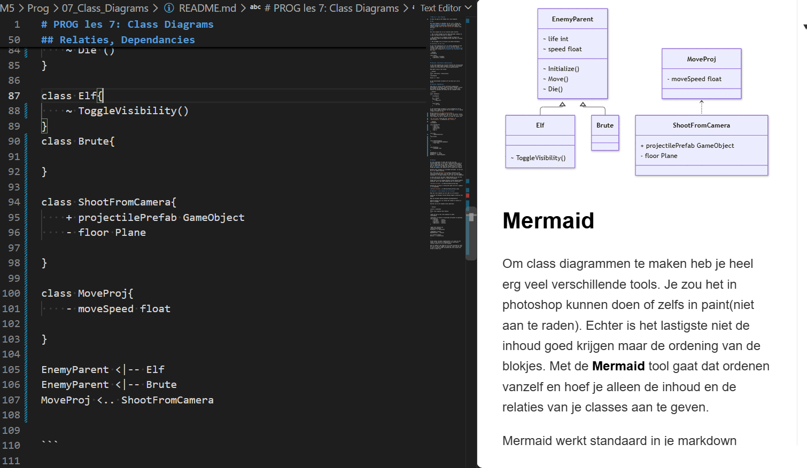

# PROG les 7: Class Diagrams

In deze les leer je wat een class diagram is en hoe je er een maakt met Mermaid.

## UML

Een class diagram is een diagram uit de **UML** (Unified Modeling Language). UML helpt je om de structuur van software zichtbaar te maken en te ontwerpen. [Lees meer over UML.](https://www.uml.org/)

## Nut

Je kunt een class diagram op drie manieren gebruiken:

1. Om bestaande code in kaart te brengen en overzicht te krijgen.

2. Om vooraf een ontwerp te maken voor de structuur van je code.

3. Om de structuur van je code aan andere ontwikkelaars uit te leggen.

## Onderdelen van een class

In een class diagram kun je de classes uit een project weergeven. Je kunt ook laten zien wat er in een class staat:

- **Attributes** zijn variabelen die bij een class horen.
- **Operations** zijn methoden van een class.



## Overerving (inheritance / generalization)

Classes kunnen ook met elkaar verbonden zijn. Bij **overerving** (inheritance, ook wel generalization genoemd) erft een child-class eigenschappen en methoden van een parent-class.

Je geeft overerving zo aan:



In dit voorbeeld erft `Child` van `Parent`.

## Afhankelijkheid (dependency)

Een class is afhankelijk van een andere class als die andere class wordt gebruikt, bijvoorbeeld om een methode aan te roepen of een waarde op te vragen. Je geeft zo'n afhankelijkheid als volgt aan:



In dit voorbeeld gebruikt `UI` de class `Player` om de waarde van `life` op te vragen. Daarom is `UI` afhankelijk van `Player`.

Bij de [opdracht over OOP en overerving](../05_OOP_Inherritance/README.md) heb je de classes `EnemyParent`, `Brute` en `Elf` geschreven. In een class diagram kunnen die er zo uitzien:

`Elf` en `Brute` erven van `EnemyParent`. `ShootFromCamera` gebruikt `MoveProj` en is daar dus afhankelijk van.



## Mermaid

Je kunt class diagrammen met verschillende tools maken. Met **Mermaid** hoef je de blokken niet zelf te ordenen: je beschrijft de classes en hun relaties, en Mermaid maakt daar een diagram van.

Mermaid-diagrammen kun je in Markdown-bestanden zetten, zoals een README.

Bekijk de [Mermaid-syntax voor class diagrams](https://mermaid.js.org/syntax/classDiagram.html) om je eigen diagrammen in Markdown-bestanden (.md) te maken.

Je kunt ook de bron van deze README bekijken om te zien hoe de voorbeelden hierboven met Mermaid zijn gemaakt.

Installeer in VS Code de extensie **Markdown Preview Mermaid Support** om je diagrammen tijdens het maken te bekijken.



Zo kun je zien hoe je diagram eruitziet terwijl je eraan werkt.



## Opdracht 7: Class Diagram van je TD project

Breng de classes en hun relaties in je TD-project in kaart met een class diagram.

1. Installeer in VS Code de extensie **Markdown Preview Mermaid Support**.
2. Maak in je PROG-repository een Markdown-bestand met de naam `ClassDiagramTD.md`.
3. Gebruik Mermaid om de classes, hun inhoud en hun relaties in kaart te brengen. Gebruik de voorbeeldsyntax hieronder.
4. Voeg een link naar `ClassDiagramTD.md` toe aan de README van je PROG-repository.
5. Zet onder het diagram in `ClassDiagramTD.md` een link naar het GitHub-project dat je in kaart hebt gebracht.

In een class diagram staat `+` voor public, `-` voor private en `#` voor protected.
````
```mermaid
%% De titel is optioneel
---
title: Class Diagram Tower Defense
---

classDiagram

%% Definieer classes met hun attributen en methoden
class MyClass{
    +int publicAttribute
    -int privateAttribute
    #int protectedAttribute
    +PublicOperation()
    -PrivateOperation()
    #ProtectedOperation()
}

%% Overerving: ChildClass erft van ParentClass
ChildClass --|> ParentClass

%% Afhankelijkheid: DependentClass gebruikt MyClass
DependentClass ..> MyClass

%% Afhankelijkheid in beide richtingen
MyClass ..> AnotherClass
AnotherClass ..> MyClass

```
````

Neem in je diagram alleen **global** variabelen op die bij een class horen (dus geen lokale variabelen die binnen een methode zijn gedefinieerd). Geef ook de afhankelijkheden en overerving tussen classes aan.
